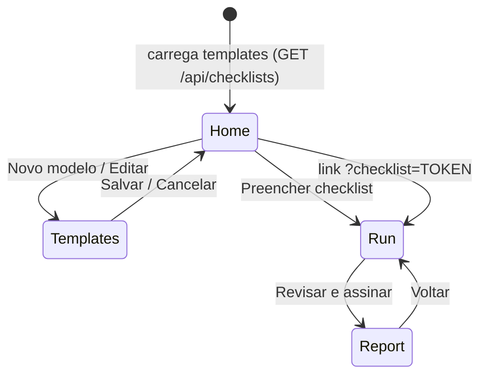
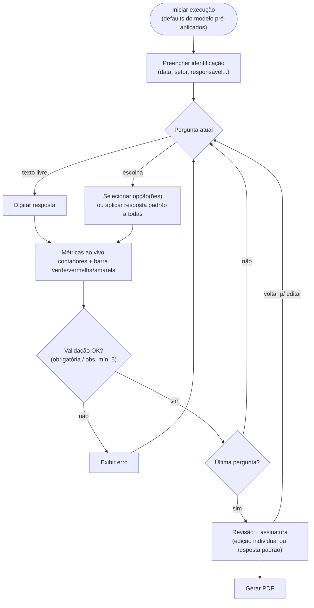
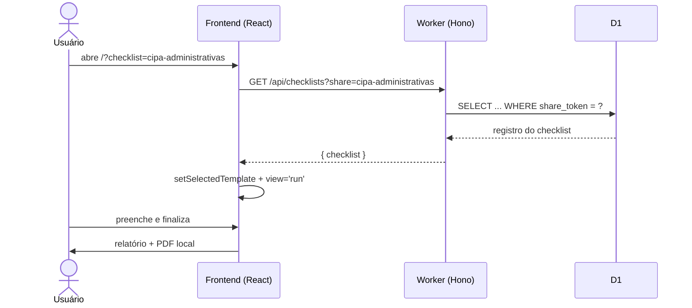
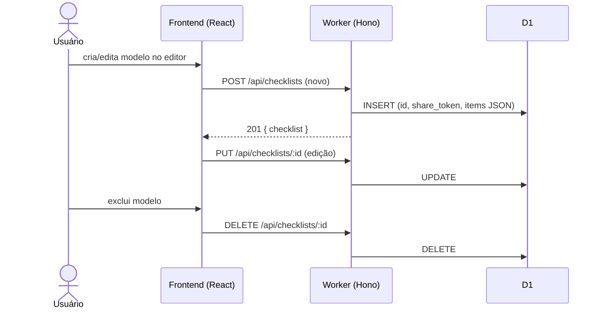
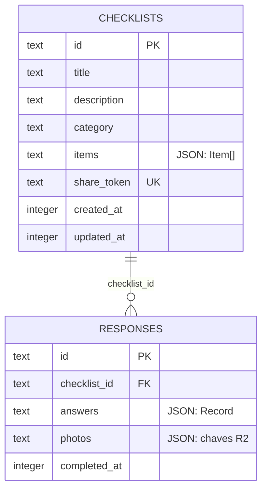

# Gerador de Conferência Polaris

Gerador de checklists genérico ("Checklist Fácil"): crie modelos de inspeção com perguntas personalizadas, preencha em campo com métricas ao vivo e gere um relatório em PDF assinado.

| | |
|---|---|
| **Frontend** | React 19 + Vite 6 (SPA) |
| **Backend** | Hono 4 em Cloudflare Workers |
| **Banco** | Cloudflare D1 (SQLite) via Drizzle ORM |
| **Arquivos** | Cloudflare R2 (fotos das respostas) |
| **PDF** | jsPDF (gerado no cliente) |
| **Testes** | `node:test` + tsx |

---

## Sumário

- [Funcionalidades](#funcionalidades)
- [Como usar](#como-usar)
  - [Criar um modelo](#1-criar-um-modelo)
  - [Preencher um checklist](#2-preencher-um-checklist)
  - [Resposta padrão em massa](#3-resposta-padrão-em-massa-metrics)
  - [Métricas e barra de progresso](#4-métricas-e-barra-de-progresso)
  - [Compartilhar por link](#5-compartilhar-por-link)
  - [Revisão e PDF](#6-revisão-e-pdf)
- [Fluxos](#fluxos)
- [API](#api)
- [Modelo de dados](#modelo-de-dados)
- [Regras de negócio](#regras-de-negócio)
- [Primeiros passos](#primeiros-passos)
- [Estrutura do projeto](#estrutura-do-projeto)

---

## Funcionalidades

- **Editor de modelos** — perguntas de escolha (única ou múltipla, 3–6 opções) ou texto livre, campos de identificação (data, setor, responsável...), importação via TXT/CSV.
- **Execução guiada** — uma pergunta por vez, com validação de obrigatórios, observações e até 4 fotos por pergunta.
- **Resposta padrão em massa** — aplique/altere a mesma opção para **todas** as perguntas com um clique.
- **Métricas ao vivo** — contadores por opção respondida, pendentes e percentual concluído, atualizados a cada etapa.
- **Barra de progresso semântica** — 🟩 verde para *Sim*, 🟥 vermelho para *Não*, 🟨 amarelo para os demais, cinza para pendentes.
- **Relatório + PDF** — revisão das respostas, assinatura e exportação A4.
- **Compartilhamento** — link direto por *share token* (`?checklist=<token>`).
- **Seed automático** — modelo CIPA (16 perguntas) inserido no primeiro acesso com banco vazio.

---

## Como usar

### 1. Criar um modelo

1. No painel inicial, clique em **Novo modelo**.
2. Informe nome, descrição e categoria.
3. Adicione perguntas:
   - **Escolha única** — botões de opção (ex.: `Sim` / `Não` / `Outros`).
   - **Escolha múltipla** — várias opções por pergunta.
   - **Texto livre** — resposta digitada.
4. Marque perguntas como **obrigatórias** quando necessário.
5. Opcionalmente, defina a **Resposta padrão** da pergunta (dentro de *Editar* → select "Resposta padrão") — ela já vem pré-aplicada quando alguém iniciar o checklist.
6. Opcionalmente adicione **campos de identificação** (ex.: Data da inspeção, Setor).
7. **Salvar** — o modelo recebe um `shareToken` automático.

> Regras do editor: mínimo de 3 e máximo de 6 opções por pergunta; a opção `"Outros"` é obrigatória e sempre a última.

### 2. Preencher um checklist

No card do modelo, clique em **Preencher**. O runner exibe uma pergunta por vez:

```
┌──────────────────────────────────────────────────────────┐
│ ← Voltar                        Etapa 3 de 16            │
│ ██████░░░░░░░░░░░░░░░░░░░░░░░░  2 de 16 respondidas  12% │
│ 🟩 Sim: 1  🟥 Não: 0  🟨 Outros: 1  ⚪ Pendentes: 14      │
│                                                          │
│ Resposta padrão [ Selecione... ▾ ] [Aplicar a todas]     │
├──────────────────────────────────────────────────────────┤
│ 3. Possui kit de primeiros socorros? *                   │
│ [ Sim ]  [ Não ]  [ Não aplicável ]  [ Em partes ]       │
│ Observações...          Fotos (máx. 4) [+ Adicionar]     │
│                                     [Anterior] [Próximo] │
└──────────────────────────────────────────────────────────┘
```

### 3. Resposta padrão em massa (metrics)

Ideal quando a maioria das respostas é igual (ex.: quase tudo `Sim`). Disponível **durante o preenchimento** e também na tela de **revisão**:

> **Defaults parametrizados no modelo:** ao criar/editar um modelo, cada pergunta pode ter uma *Resposta padrão* configurada no editor. Ela é pré-aplicada automaticamente no início da execução (`buildInitialAnswers`), e o seletor em massa continua disponível para alterar tudo depois.

1. Selecione a opção desejada no seletor **Resposta padrão** (união das opções de todas as perguntas).
2. Clique em **Aplicar a todas as perguntas** — todos os itens de escolha que possuírem aquela opção passam a ter essa resposta.
3. Para corrigir, selecione outra opção e reaplique — **substitui** as anteriores.
4. Ajustes pontuais: navegue até a pergunta e responda normalmente.

Comportamento:

| Situação | Resultado |
|---|---|
| Pergunta de escolha única | resposta substituída pela padrão |
| Pergunta de escolha múltipla | resposta substituída pela padrão |
| Pergunta sem aquela opção | permanece intocada |
| Pergunta de texto livre | permanece intocada |

### 4. Métricas e barra de progresso

Os contadores são recalculados a cada resposta (`domain/metrics.ts`):

- **Contadores por opção** — quantas vezes cada opção foi marcada no conjunto completo.
- **Pendentes** — perguntas ainda sem resposta.
- **Percentual** — respondidas ÷ total.

Classificação de cores na barra segmentada:

| Resposta (comparação exata, sem acento/caixa) | Classe | Cor |
|---|---|---|
| `Sim` | `yes` | 🟩 `#22c55e` |
| `Não` / `nao` | `no` | 🟥 `#ef4444` |
| `Não aplicável`, `Em partes`, `Outros`, ... | `other` | 🟨 `#eab308` |
| sem resposta | `pending` | ⚪ `#e3e4dc` |

> Atenção: `Não aplicável` conta como **amarelo**, pois só o termo exato `Não` é vermelho.

### 5. Compartilhar por link

Cada modelo tem um token curto. Envie o link:

```
https://<seu-worker>.workers.dev/?checklist=cipa-administrativas
```

Quem abrir já cai direto na tela de preenchimento daquele modelo.

### 6. Revisão e PDF

Ao responder a última pergunta, clique em **Revisar e assinar**. A tela de revisão também é **editável**:

- **Resposta padrão em massa** — o mesmo seletor "Aplicar a todas as perguntas" está disponível para corrigir tudo de uma vez.
- **Edição individual** — cada pergunta pode ser alterada na hora (botões de opção ou texto livre).
- **Métricas ao vivo** — a barra verde/vermelha/amarela e os contadores refletem as edições.
- **Alerta de obrigatórias** — perguntas obrigatórias sem resposta ficam com borda laranja.

Depois, desenhe a assinatura e gere o PDF A4 (gerado localmente no navegador via jsPDF) já com as respostas editadas.

---

## Fluxos

### Navegação geral (views)



### Execução do checklist (runner)



### Leitura via link compartilhado



### Ciclo de vida de um modelo (CRUD)



### Modelo de dados



---

## API

Base: `https://<seu-worker>.workers.dev`

| Método | Rota | Descrição |
|---|---|---|
| `GET` | `/api/checklists` | lista os últimos 100 modelos (insere o seed CIPA se vazio) |
| `GET` | `/api/checklists?share=<token>` | busca por share token **ou** id |
| `POST` | `/api/checklists` | cria modelo |
| `PUT` | `/api/checklists/:id` | atualiza modelo |
| `DELETE` | `/api/checklists/:id` | exclui modelo |
| `POST` | `/api/checklists/:id/responses` | persiste resposta (+ fotos no R2) |

### Exemplos

Criar um modelo:

```bash
curl -X POST https://<seu-worker>.workers.dev/api/checklists \
  -H "Content-Type: application/json" \
  -d '{
    "title": "Inspeção de EPI",
    "description": "Verificação mensal de EPIs",
    "category": "Segurança do Trabalho",
    "items": [
      {
        "id": "epi-1",
        "title": "Os EPIs estão dentro da validade?",
        "required": true,
        "answerType": "choice",
        "selection": "single",
        "options": ["Sim", "Não", "Outros"]
      },
      {
        "id": "epi-2",
        "title": "Quais EPIs foram entregues?",
        "required": false,
        "answerType": "choice",
        "selection": "multiple",
        "options": ["Capacete", "Luva", "Bota", "Outros"]
      },
      {
        "id": "epi-3",
        "title": "Observações gerais",
        "required": false,
        "answerType": "text",
        "selection": "single",
        "options": []
      }
    ]
  }'
```

Listar / buscar:

```bash
curl https://<seu-worker>.workers.dev/api/checklists
curl "https://<seu-worker>.workers.dev/api/checklists?share=cipa-administrativas"
```

---

## Modelo de dados (domínio)

```ts
// domain/checklist.ts
interface Item {
  id: string;
  title: string;
  required: boolean;
  options: string[];              // rótulos das opções
  answerType: 'text' | 'choice';
  selection: 'single' | 'multiple';
  defaultOption?: string;         // resposta padrão (pré-aplicada na execução)
}

type Answers  = Record<string, string[]>; // itemId -> opções selecionadas
type Metadata = Record<string, string>;   // fieldId -> valor digitado

buildInitialAnswers(items) // Answers iniciais a partir dos defaults do modelo
```

Funções puras de métricas (`domain/metrics.ts`):

```ts
classifyAnswer('Sim')            // 'yes'
classifyAnswer('Não')            // 'no'
classifyAnswer('Não aplicável')  // 'other'

computeAnswerMetrics(items, answers)
// { total, answered, pending, yes, no, other, byOption }

applyDefaultAnswer(items, answers, 'Sim') // aplica/substitui em massa
collectChoiceOptions(items)               // união das opções p/ o seletor
```

---

## Regras de negócio

- Perguntas **obrigatórias** bloqueiam o avanço sem resposta.
- **Observações** gerais: vazias ou com no mínimo 5 caracteres (validadas ao finalizar).
- **Fotos**: máximo de 4 por pergunta, 10 MB cada.
- **Opções**: 3 a 6 por pergunta; `Outros` sempre presente e último.
- **Resposta padrão por pergunta**: configurável no editor (`Item.defaultOption`); deve pertencer às opções da pergunta — renomear/remover a opção limpa o default automaticamente. Perguntas de texto livre não aceitam default.
- **Seed CIPA**: inserido automaticamente no primeiro `GET /api/checklists` com banco vazio (id `cipa-areas-administrativas`, token `cipa-administrativas`).
- **PDF** é gerado no cliente; o endpoint de `responses` existe para persistência futura (fotos → R2).

---

## Primeiros passos

### Requisitos

- Node.js 20+
- Conta Cloudflare (para deploy; o desenvolvimento local usa simulação via Wrangler/Vite plugin)

### Desenvolvimento

```bash
npm install
npm run db:migrate:local   # aplica migrations no D1 local
npm run dev                # abre http://localhost:5173
```

### Testes e qualidade

```bash
npm test                   # node:test + tsx (domínio, métricas, renderização)
npm run lint               # eslint
npx tsc --noEmit           # checagem de tipos
```

### Deploy

```bash
# 1. Criar recursos (uma única vez)
wrangler d1 create checklist-facil-db
wrangler r2 bucket create checklist-facil-photos

# 2. Colar o database_id retornado em wrangler.jsonc
#    ("REPLACE_WITH_D1_DATABASE_ID")

# 3. Migrar e publicar
npm run db:migrate:remote
npm run deploy             # vite build + wrangler deploy
```

---

## Estrutura do projeto

```
gerador_conferencia_polaris/
├── app/
│   ├── App.tsx                     # estado global + roteamento por view
│   ├── main.tsx                    # entry point
│   ├── globals.css                 # estilos base
│   └── api/checklists/             # handlers estilo file-routing (montados no Hono)
│       ├── route.ts                # GET (lista/share) + POST
│       └── [id]/
│           ├── route.ts            # PUT + DELETE
│           └── responses/route.ts  # POST resposta (D1 + R2)
├── components/
│   ├── dashboard/Dashboard.tsx     # home: hero + grid de modelos
│   ├── layout/AppShell.tsx         # sidebar + layout
│   ├── metrics/
│   │   ├── AnswerMetricsBar.tsx    # barra segmentada + contadores (runner e revisão)
│   │   └── BulkDefaultControl.tsx  # seletor "Resposta padrão" + aplicar em massa
│   ├── report/ReportReview.tsx     # revisão editável + assinatura + PDF
│   ├── runner/ChecklistRunner.tsx  # execução: etapas, resposta padrão, métricas
│   └── templates/
│       ├── TemplateCard.tsx        # card de modelo
│       └── TemplateEditor.tsx      # editor de perguntas/opções
├── db/
│   ├── schema.ts                   # tabelas checklists + responses (Drizzle)
│   ├── seed.ts                     # CIPA_SEED (16 perguntas)
│   └── index.ts                    # createDb()
├── domain/
│   ├── checklist.ts                # tipos: Template, Item, Answers...
│   ├── metrics.ts                  # classificação, contadores, default em massa
│   └── constants.ts                # cores, limites, config PDF/fotos
├── lib/pdf.ts                      # geração de PDF (jsPDF)
├── worker/index.ts                 # Hono: rotas /api/* + fallback ASSETS
├── drizzle/                        # migrations SQL
├── tests/                          # node:test (domínio, métricas, HTML)
├── vite.config.ts                  # Vite + plugin Cloudflare
└── wrangler.jsonc                  # bindings D1 (DB) e R2 (BUCKET)
```

---

## Licença

Consulte o arquivo [LICENSE](LICENSE).
