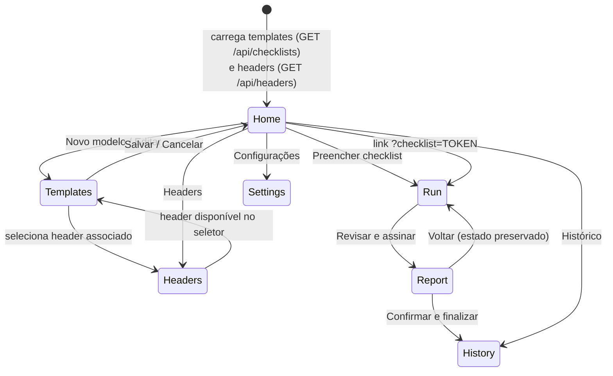
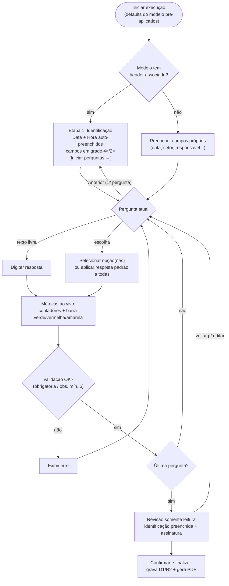
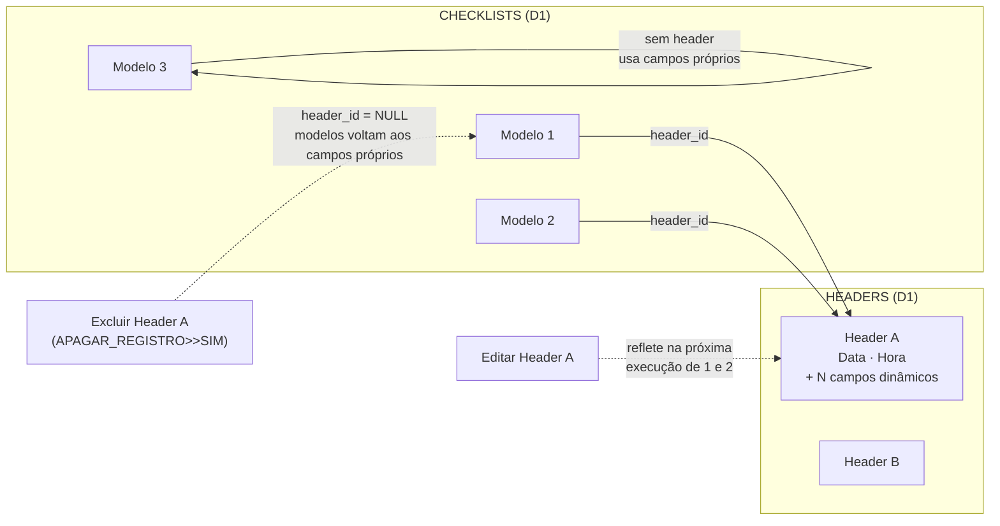
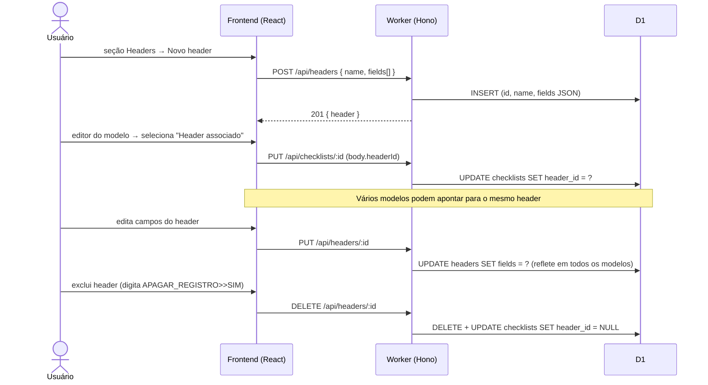
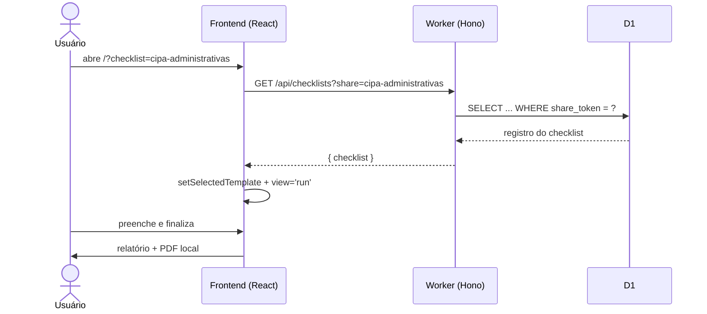
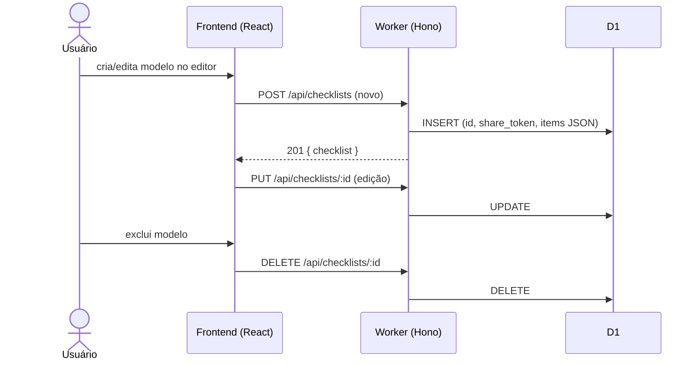
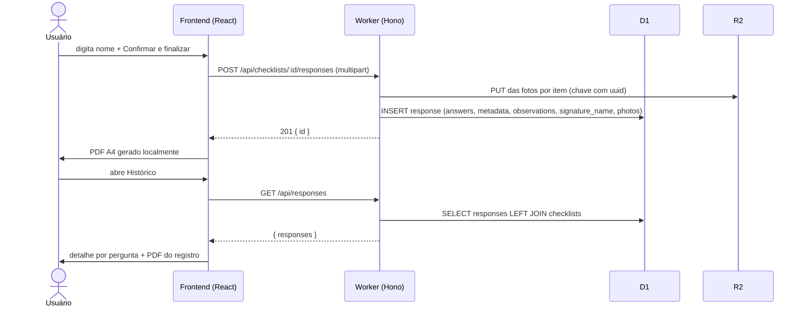
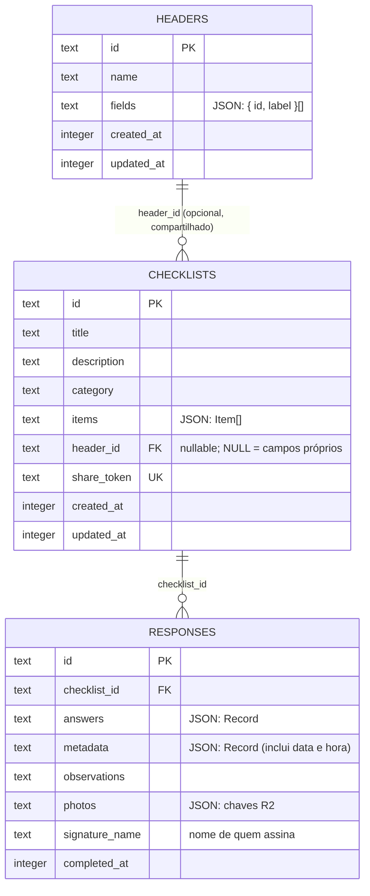
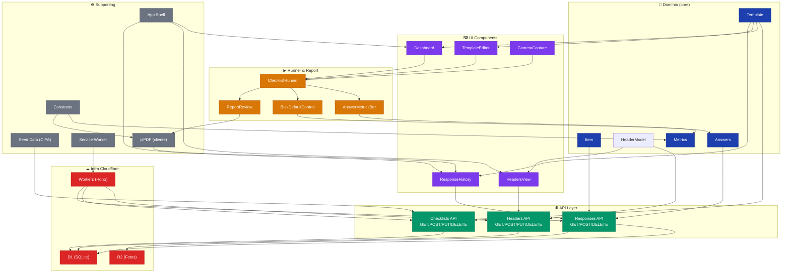

# Gerador de Conferência Polaris

Gerador de checklists genérico ("Gerador de Checklists"): crie modelos de inspeção com perguntas personalizadas, preencha em campo com métricas ao vivo e gere um relatório em PDF assinado.

|              |                                        |
| ------------ | -------------------------------------- |
| **Frontend** | React 19 + Vite 6 (SPA)                |
| **Estilos**  | Tailwind CSS 4 (`@theme`) + constantes de classe |
| **Backend**  | Hono 4 em Cloudflare Workers           |
| **Banco**    | Cloudflare D1 (SQLite) via Drizzle ORM |
| **Arquivos** | Cloudflare R2 (fotos das respostas)    |
| **PDF**      | jsPDF (gerado no cliente)              |
| **Testes**   | `node:test` + tsx                      |

---

## Sumário

- [Funcionalidades](#funcionalidades)
- [Como usar](#como-usar)
  - [Criar um modelo](#1-criar-um-modelo)
  - [Headers de identificação](#2-headers-de-identificação)
  - [Preencher um checklist](#3-preencher-um-checklist)
  - [Resposta padrão em massa](#4-resposta-padrão-em-massa-metrics)
  - [Métricas e barra de progresso](#5-métricas-e-barra-de-progresso)
  - [Compartilhar por link](#6-compartilhar-por-link)
  - [Revisão e PDF](#7-revisão-e-pdf)
  - [Histórico](#8-histórico)
- [Fluxos](#fluxos)
- [API](#api)
- [Modelo de dados](#modelo-de-dados)
- [Regras de negócio](#regras-de-negócio)
- [Primeiros passos](#primeiros-passos)
- [Estrutura do projeto](#estrutura-do-projeto)
- [Arquitetura](#arquitetura)

---

## Funcionalidades

- **Editor de modelos** — perguntas de escolha (única ou múltipla, 3–6 opções) ou texto livre, campos de identificação (data, setor, responsável...), importação via TXT/CSV.
- **Headers de identificação reutilizáveis** — conjuntos de campos (Data, Hora, Unidade, Andar, Coordenador, Matrículas, Responsável...) criados uma vez e associados a vários modelos; alterar o header reflete em todos. Primeira etapa da execução e grade responsiva (4 colunas no desktop, 2 no mobile).
- **Execução guiada** — uma pergunta por vez, com validação de obrigatórios, observações e até 4 fotos por pergunta.
- **Resposta padrão em massa** — aplique/altere a mesma opção para **todas** as perguntas com um clique.
- **Métricas ao vivo** — contadores por opção respondida, pendentes e percentual concluído, atualizados a cada etapa.
- **Barra de progresso semântica** — 🟩 verde para _Sim_, 🟥 vermelho para _Não_, 🟨 amarelo para os demais, cinza para pendentes.
- **Relatório + PDF** — revisão das respostas, assinatura e exportação A4 com indicadores do preenchimento.
- **Persistência + Histórico** — cada preenchimento confirmado é gravado no D1 (respostas, identificação e observações) com fotos no R2; consulte tudo depois em **Histórico**, com detalhe por pergunta e PDF do registro.
- **Câmera in-app (PWA)** — tire fotos pela câmera do dispositivo ou escolha da galeria; app instalável via service worker.
- **Tema claro/escuro** — alternância no menu lateral com ícone ☀️/🌙; a preferência fica salva no navegador e, sem escolha, segue o tema do sistema. O PDF é sempre gerado em tema claro.
- **UI consistente via constantes** — botões e campos usam classes reutilizáveis (`BTN_PRIMARY`, `BTN_SUCCESS`, `BTN_WARNING`, `BTN_DANGER`, `INPUT`, `CARD`...): azul para navegação/ação primária, verde para adicionar/editar confirmar positivo, laranja para cancelar, vermelho para excluir — sempre com contraste adequado nos dois temas.
- **Compartilhamento** — link direto por _share token_ (`?checklist=<token>`).
- **Seed automático** — modelo CIPA (16 perguntas) inserido no primeiro acesso com banco vazio.

---

## Como usar

### 1. Criar um modelo

1. No painel inicial, clique em **Novo modelo**.
2. Informe nome, descrição e categoria.
3. Adicione perguntas:
   - **Escolha única** — botões de opção (ex.: `Sim` / `Não` / `Outros`).
   - **Escolha múltipla** — várias opções por pergunta.
   - **Texto livre** — resposta digitada.
4. Marque perguntas como **obrigatórias** quando necessário.
5. Opcionalmente, marque o checkbox **Padrão** na opção desejada da pergunta (dentro de _Editar_) — ela já vem pré-aplicada quando alguém iniciar o checklist; perguntas sem marcação são respondidas individualmente. Perguntas novas já nascem com `Sim` marcado.
6. Opcionalmente adicione **campos de identificação** próprios (ex.: Data da inspeção, Setor).
7. Opcionalmente selecione um **Header associado** no seletor do editor — a identificação passa a vir do header (veja a seção abaixo). Modelos sem header continuam usando os campos próprios.
8. **Salvar** — o modelo recebe um `shareToken` automático.

> Regras do editor: mínimo de 3 e máximo de 6 opções por pergunta; a opção `"Outros"` é obrigatória e sempre a última.

### 2. Headers de identificação

No menu lateral, **Headers** gerencia conjuntos reutilizáveis de campos de identificação:

- **Campos fixos** — todo header tem `Data` e `Hora` na primeira linha, auto-preenchidos com o momento da execução e editáveis.
- **Campos adicionais** — ao criar, vêm pré-carregados: Unidade, Andar, Coordenador, Matrícula do Coordenador, Responsável pela Avaliação e Matrícula do Responsável. É possível renomear, remover e **+ Adicionar campo**.
- **Vínculo compartilhado** — vários modelos podem apontar para o mesmo header; editar o header atualiza a identificação de todos eles na próxima execução.
- **Coexistência** — modelos sem header associado seguem usando os campos próprios do editor (`Template.fields`).
- **Exclusão protegida** — excluir exige digitar `APAGAR_REGISTRO>>SIM`; os modelos vinculados ficam com `header_id = NULL` (voltam aos campos próprios) sem quebrar nada.

### 3. Preencher um checklist

No card do modelo, clique em **Preencher**:

- **Com header associado**, a execução abre na **etapa de Identificação**: data/hora + todos os campos em grade responsiva (**4 colunas** no desktop, **2 colunas** no mobile). Clique em **Iniciar perguntas →** para começar; "Anterior" na 1ª pergunta volta para cá.

Depois, uma pergunta por vez:

```
┌──────────────────────────────────────────────────────────┐
│ ← Voltar                        Etapa 3 de 16            │
│ ██████░░░░░░░░░░░░░░░░░░░░░░░░  2 de 16 respondidas  12% │
│ 🟩 Sim: 1  🟥 Não: 0  🟨 Outros: 1  ⚪ Pendentes: 14   │
│                                                          │
│ Resposta padrão [ Selecione... ▾ ] [Aplicar a todas]     │
├──────────────────────────────────────────────────────────┤
│ 3. Possui kit de primeiros socorros? *                   │
│ [ Sim ]  [ Não ]  [ Não aplicável ]  [ Em partes ]       │
│ Observações...  Fotos (máx. 4) [Tirar foto] [+ Galeria]  │
│                                     [Anterior] [Próximo] │
└──────────────────────────────────────────────────────────┘
```

### 4. Resposta padrão em massa (metrics)

Ideal quando a maioria das respostas é igual (ex.: quase tudo `Sim`). Disponível **durante o preenchimento**:

> **Defaults parametrizados no modelo:** ao criar/editar um modelo, cada pergunta pode ter uma _Resposta padrão_ configurada no editor. Ela é pré-aplicada automaticamente no início da execução (`buildInitialAnswers`), e o seletor em massa continua disponível para alterar tudo depois.

1. Selecione a opção desejada no seletor **Resposta padrão** (união das opções de todas as perguntas).
2. Clique em **Aplicar a todas as perguntas** — todos os itens de escolha que possuírem aquela opção passam a ter essa resposta.
3. Para corrigir, selecione outra opção e reaplique — **substitui** as anteriores.
4. Ajustes pontuais: navegue até a pergunta e responda normalmente.

Comportamento:

| Situação                     | Resultado                        |
| ---------------------------- | -------------------------------- |
| Pergunta de escolha única    | resposta substituída pela padrão |
| Pergunta de escolha múltipla | resposta substituída pela padrão |
| Pergunta sem aquela opção    | permanece intocada               |
| Pergunta de texto livre      | permanece intocada               |

### 5. Métricas e barra de progresso

Os contadores são recalculados a cada resposta (`domain/metrics.ts`):

- **Contadores por opção** — quantas vezes cada opção foi marcada no conjunto completo.
- **Pendentes** — perguntas ainda sem resposta.
- **Percentual** — respondidas ÷ total.

Classificação de cores na barra segmentada:

| Resposta (comparação exata, sem acento/caixa) | Classe    | Cor          |
| --------------------------------------------- | --------- | ------------ |
| `Sim`                                         | `yes`     | 🟩 `#22c55e` |
| `Não` / `nao`                                 | `no`      | 🟥 `#ef4444` |
| `Não aplicável`, `Em partes`, `Outros`, ...   | `other`   | 🟨 `#eab308` |
| sem resposta                                  | `pending` | ⚪ `#e3e4dc` |

> Atenção: `Não aplicável` conta como **amarelo**, pois só o termo exato `Não` é vermelho.

### 6. Compartilhar por link

Cada modelo tem um token curto. Envie o link:

```
https://<seu-worker>.workers.dev/?checklist=cipa-administrativas
```

Quem abrir já cai direto na tela de preenchimento daquele modelo.

### 7. Revisão e PDF

Ao responder a última pergunta, clique em **Revisar e assinar**. A revisão é **somente leitura** — para corrigir algo, use **Voltar ao preenchimento**: todas as respostas, observações e fotos são preservadas. A identificação do header aparece preenchida (data/hora na primeira linha + campos em grade).

Depois, digite o **nome de quem assina**, marque a confirmação e clique em **Confirmar e finalizar**:

- o registro é gravado no banco (respostas, identificação, observações e nome no D1; fotos no R2);
- o **PDF A4** é gerado localmente no navegador via jsPDF: cabeçalho com **título e descrição do modelo**, identificação (data/hora + campos), os **indicadores da tela** (Sim / Não / Outros / Pendentes + % concluído) e o rodapé com **nome centralizado** acima de "Checklist feito e finalizado em".

### 8. Histórico

No menu lateral, **Histórico** lista os últimos 100 preenchimentos gravados:

- **Resumo** — modelo, categoria, data/hora, contadores 🟩/🟥/🟨, campos de identificação, observações e nº de fotos.
- **Ver respostas** — expande o registro mostrando pergunta por pergunta com a resposta dada; se o modelo foi editado/excluído depois, exibe os valores registrados na época.
- **📄 Baixar PDF** — regenera o relatório A4 do registro com o **nome de quem assinou**, as fotos gravadas no R2 e o layout de identificação do header associado ao modelo.
- **🗑 Excluir** — remove o registro (modal genérico com confirmação digitada `APAGAR_REGISTRO>>SIM`).

---

## Fluxos

### Navegação geral (views)



### Execução do checklist (runner)

Com **header associado**, a identificação é a primeira etapa; sem header, o fluxo segue direto para as perguntas:



### Vínculo Header ↔ Modelos

O header é **compartilhado**: vários modelos apontam para o mesmo registro, e edições nele refletem em todos. A exclusão limpa o vínculo sem apagar os modelos.



### Ciclo de vida de um header (CRUD + associação)



### Leitura via link compartilhado



### Ciclo de vida de um modelo (CRUD)



### Persistência do preenchimento



### Modelo de dados



---

## API

Base: `https://<seu-worker>.workers.dev`

| Método     | Rota                            | Descrição                                                  |
| ---------- | ------------------------------- | ---------------------------------------------------------- |
| `GET`      | `/api/checklists`               | lista os últimos 100 modelos (insere o seed CIPA se vazio) |
| `GET`      | `/api/checklists?share=<token>` | busca por share token **ou** id                            |
| `POST`     | `/api/checklists`               | cria modelo                                                |
| `PUT`      | `/api/checklists/:id`           | atualiza modelo                                            |
| `DELETE`   | `/api/checklists/:id`           | exclui modelo                                              |
| `POST`     | `/api/checklists/:id/responses` | grava a resposta no D1 (+ fotos no R2)                     |
| `GET`      | `/api/responses`                | lista os últimos 100 preenchimentos (histórico)            |
| `DELETE`   | `/api/responses/:id`            | exclui um preenchimento (+ fotos no R2)                    |
| `GET`      | `/api/headers`                  | lista os headers de identificação                          |
| `POST`     | `/api/headers`                  | cria header (`{ name, fields[] }`)                         |
| `PUT`      | `/api/headers/:id`              | atualiza header (reflete em todos os modelos vinculados)   |
| `DELETE`   | `/api/headers/:id`              | exclui header e limpa `header_id` dos modelos vinculados   |
| `GET/POST` | `/api/settings`                 | logo do app (R2) + cor de fundo                            |
| `GET`      | `/api/files/*`                  | serve arquivos do R2 (`settings/`, `responses/`)           |

### Exemplos

Criar um modelo:

```bash
curl -X POST https://<seu-worker>.workers.dev/api/checklists \
  -H "Content-Type: application/json" \
  -d '{
    "title": "Inspeção de EPI",
    "description": "Verificação mensal de EPIs",
    "category": "Segurança do Trabalho",
    "items": [
      {
        "id": "epi-1",
        "title": "Os EPIs estão dentro da validade?",
        "required": true,
        "answerType": "choice",
        "selection": "single",
        "options": ["Sim", "Não", "Outros"]
      },
      {
        "id": "epi-2",
        "title": "Quais EPIs foram entregues?",
        "required": false,
        "answerType": "choice",
        "selection": "multiple",
        "options": ["Capacete", "Luva", "Bota", "Outros"]
      },
      {
        "id": "epi-3",
        "title": "Observações gerais",
        "required": false,
        "answerType": "text",
        "selection": "single",
        "options": []
      }
    ]
  }'
```

Listar / buscar:

```bash
curl https://<seu-worker>.workers.dev/api/checklists
curl "https://<seu-worker>.workers.dev/api/checklists?share=cipa-administrativas"
```

Criar um header de identificação e associá-lo a um modelo:

```bash
# 1. Criar o header (Data e Hora são fixas; fields[] são os campos adicionais)
curl -X POST https://<seu-worker>.workers.dev/api/headers \
  -H "Content-Type: application/json" \
  -d '{
    "name": "Inspeção Administrativa",
    "fields": [
      { "id": "unidade", "label": "Unidade" },
      { "id": "andar", "label": "Andar" },
      { "id": "coordenador", "label": "Coordenador" },
      { "id": "responsavel", "label": "Responsável pela Avaliação" }
    ]
  }'

# 2. Associar ao modelo (ou via seletor no editor)
curl -X PUT https://<seu-worker>.workers.dev/api/checklists/<id> \
  -H "Content-Type: application/json" \
  -d '{ "title": "...", "items": [ ... ], "headerId": "<id-do-header>" }'
```

---

## Modelo de dados (domínio)

```ts
// domain/checklist.ts
interface Item {
  id: string;
  title: string;
  required: boolean;
  options: string[]; // rótulos das opções
  answerType: "text" | "choice";
  selection: "single" | "multiple";
  defaultOption?: string; // resposta padrão (pré-aplicada na execução)
}

interface Template {
  ...
  headerId?: string; // header de identificação associado (opcional)
}

type Answers = Record<string, string[]>; // itemId -> opções selecionadas
type Metadata = Record<string, string>; // fieldId -> valor digitado (data, hora e campos do header)

buildInitialAnswers(items); // Answers iniciais a partir dos defaults do modelo
```

```ts
// domain/header.ts
interface HeaderField {
  id: string;
  label: string;
}

interface HeaderModel {
  id: string;
  name: string;
  fields: HeaderField[]; // campos dinâmicos; Data e Hora são fixas em todo header
}

HEADER_DEFAULT_FIELDS; // Unidade, Andar, Coordenador, Matrícula do Coordenador,
// Responsável pela Avaliação, Matrícula do Responsável
```

Funções puras de métricas (`domain/metrics.ts`):

```ts
classifyAnswer("Sim"); // 'yes'
classifyAnswer("Não"); // 'no'
classifyAnswer("Não aplicável"); // 'other'

computeAnswerMetrics(items, answers);
// { total, answered, pending, yes, no, other, byOption }

applyDefaultAnswer(items, answers, "Sim"); // aplica/substitui em massa
collectChoiceOptions(items); // união das opções p/ o seletor
```

---

## Regras de negócio

- Perguntas **obrigatórias** bloqueiam o avanço sem resposta.
- **Observações** gerais: vazias ou com no mínimo 5 caracteres (validadas ao finalizar).
- **Fotos**: máximo de 4 por pergunta, 10 MB cada.
- **Opções**: 3 a 6 por pergunta; `Outros` sempre presente e último.
- **Resposta padrão por pergunta**: configurável no editor (`Item.defaultOption`); deve pertencer às opções da pergunta — renomear/remover a opção limpa o default automaticamente. Perguntas de texto livre não aceitam default.
- **Seed CIPA**: inserido automaticamente no primeiro `GET /api/checklists` com banco vazio (id `cipa-areas-administrativas`, token `cipa-administrativas`).
- **Headers**: Data e Hora são fixas em todo header (auto-preenchidas com o momento da execução, editáveis); os demais campos são dinâmicos. O vínculo é **compartilhado** — editar o header reflete em todos os modelos associados. Modelos sem header usam os campos próprios do editor. Excluir um header zera `header_id` dos modelos vinculados (nunca apaga modelos). Na execução, a identificação é a **primeira etapa**; na revisão e no PDF aparece preenchida (grade 4×/2× na web, 2 colunas no PDF).
- **PDF** é gerado no cliente. Ao confirmar, a resposta vai ao D1 (colunas `metadata`, `observations` e `signature_name`) e cada foto ao R2 com chave única por item. Fotos são normalizadas para 800×450 JPEG (q=0.6) antes de entrar na memória/R2/PDF.
- **Assinatura**: é o nome digitado ("Nome completo"), gravado em `signature_name` e impresso centralizado no rodapé do PDF, acima de "Checklist feito e finalizado em". Regenerações pelo Histórico reutilizam o nome salvo.
- **Exclusões** (modelos e registros de histórico): sempre via modal genérico exigindo digitar `APAGAR_REGISTRO>>SIM`.
- **Histórico**: os últimos 100 preenchimentos, com título/categoria resolvidos via LEFT JOIN (modelo excluído não quebra a listagem).
- **Cabeçalho do PDF**: título e descrição do modelo + chips de métricas (Sim / Não / Outros / Pendentes) com % concluído.
- **Marca visual**: azul institucional `#005ca9` (tema, favicon e cabeçalho do PDF); as cores de métrica 🟩🟥🟨 permanecem semânticas.
- **Estilos (Tailwind 4)**: paleta institucional declarada em `@theme` (`globals.css`) — `corPadrao`, `mint`, `orange`, `cream`, `line`, `ink`, `surface` e `metric-*`. Componentes usam classes utilitárias + constantes compartilhadas de `components/ui/classes.ts` em vez de estilos inline.
- **Tema escuro**: a classe `.dark` no `<html>` apenas **troca os tokens** da paleta (superfícies escuras, azul/laranja mais claros) — todos os componentes mudam juntos, sem CSS duplicado. Preferência em `localStorage` (chave `theme`) + script anti-flash no `index.html`; sem preferência salva, segue `prefers-color-scheme`.
- **PDF sempre claro**: o jsPDF usa os hexes fixos de `domain/constants.ts`, sem qualquer dependência do tema da interface.
- **Service worker**: registrado somente em builds de produção (`import.meta.env.PROD`) para não interferir no HMR do Vite durante o desenvolvimento.

---

## Primeiros passos

### Requisitos

- Node.js 20+
- Conta Cloudflare (para deploy; o desenvolvimento local usa simulação via Wrangler/Vite plugin)

### Desenvolvimento

```bash
npm install
npm run db:migrate:local   # aplica migrations no D1 local
npm run dev                # abre http://localhost:5173
```

### Testes e qualidade

```bash
npm test                   # node:test + tsx (domínio, métricas, renderização)
npm run lint               # eslint
npx tsc --noEmit           # checagem de tipos
```

### Deploy

#### A. Primeira publicação (criação dos recursos)

```bash
# 1. Autenticar no Cloudflare (abre o navegador)
npx wrangler login

# 2. Criar o banco D1 e anotar o database_id retornado
npx wrangler d1 create checklist-facil-db

# 3. Colar o database_id em wrangler.jsonc
#    (substitui o placeholder "REPLACE_WITH_D1_DATABASE_ID")

# 4. Ativar o R2 no dashboard (uma vez por conta):
#    https://dash.cloudflare.com/?to=/:account/r2 → "Enable R2"
#    e então criar o bucket de fotos:
npx wrangler r2 bucket create checklist-facil-photos

# 5. Aplicar as migrations no banco remoto
npm run db:migrate:remote

# 6. Publicar (vite build + wrangler deploy)
npm run deploy
```

> **Levar os dados locais junto (opcional):**
>
> ```bash
> # exporta o D1 local
> npx wrangler d1 export checklist-facil-db --local --output=backup-local.sql
>
> # remove do dump as linhas de d1_migrations, sqlite_sequence e CREATE TABLE/INDEX
> # (o remoto já tem o schema aplicado pelo passo 5)
>
> # importa só os INSERTs de dados
> npx wrangler d1 execute checklist-facil-db --remote --file=backup-data.sql -y
> ```
>
> Fotos/logo do R2 local: para cada chave gravada no D1 (`responses.photos` e `settings.logo_r2_key`),
> baixe do bucket local e envie ao remoto:
>
> ```bash
> npx wrangler r2 object get checklist-facil-photos/<chave> --file=<tmp> --local
> npx wrangler r2 object put checklist-facil-photos/<chave> --file=<tmp> --remote --content-type=image/jpeg
> ```

#### B. Deploy rotineiro (dia a dia)

```bash
npm run lint && npm test     # sanity check
npm run deploy               # build + publicação
```

A URL fica em `https://checklist-facil.<seu-subdominio>.workers.dev` (mostrada ao final do deploy).
Migrations novas, quando houver: `npm run db:migrate:remote` antes do deploy.

---

## Arquitetura

> Grafo interativo completo: [graph.html](graphify-out/graph.html)



**Comunidades detectadas** (graphify — 16 comunidades, 285 nós, 563 arestas):

| Comunidade | Cohesion | Nó central |
|------------|----------|------------|
| Headers API Layer | 0.11 | `HeaderModel` |
| UI Components | 0.13 | `Template` |
| Checklists API Layer | 0.11 | `Template` |
| Metrics & Progress UI | 0.12 | `Template` |
| Seed Data & Constants | 0.12 | `CIPA_SEED` |
| App Shell & Navigation | 0.36 | `AppShell` |
| Database Schema | 0.25 | `DB` |
| Documentation & Assets | 0.24 | `index.html` |

`Template` é o **god node** (20 arestas, betweenness 0.039) — ponte entre UI, API, Metrics, Seed e App Shell.

---

## Estrutura do projeto

```
gerador_conferencia_polaris/
├── app/
│   ├── App.tsx                     # estado global + roteamento por view
│   ├── main.tsx                    # entry point + service worker (só em produção)
│   ├── globals.css                 # Tailwind 4: @theme com a paleta + overrides .dark (tema escuro)
│   ├── api/checklists/             # handlers estilo file-routing (montados no Hono)
│   │   ├── route.ts                # GET (lista/share) + POST
│   │   └── [id]/
│   │       ├── route.ts            # PUT + DELETE
│   │       └── responses/route.ts  # POST resposta (D1 + R2)
│   ├── api/responses/route.ts      # GET histórico de preenchimentos
│   └── api/headers/                # CRUD de headers de identificação
│       ├── route.ts                # GET lista + POST cria
│       └── [id]/route.ts           # PUT atualiza + DELETE (limpa vínculos)
├── components/
│   ├── camera/CameraCapture.tsx     # câmera in-app (getUserMedia) para fotos
│   ├── dashboard/Dashboard.tsx     # home: hero + grid de modelos
│   ├── headers/HeadersView.tsx     # CRUD de headers + modal de exclusão
│   ├── history/ResponseHistory.tsx # histórico: resumo, detalhe, PDF e exclusão por registro
│   ├── layout/AppShell.tsx         # sidebar + logo + layout + toggle de tema ☀️/🌙
│   ├── main/
│   │   ├── ConfirmModal.tsx        # modal genérico (confirmação digitada)
│   │   └── MainHero.tsx            # hero reutilizável da home
│   ├── metrics/
│   │   ├── AnswerMetricsBar.tsx    # barra segmentada + contadores (runner e revisão)
│   │   └── BulkDefaultControl.tsx  # seletor "Resposta padrão" + aplicar em massa
│   ├── report/ReportReview.tsx     # revisão somente leitura + persistência + PDF
│   ├── runner/ChecklistRunner.tsx  # execução: identificação (1ª etapa), etapas, métricas
│   ├── settings/SettingsView.tsx   # logo do app (R2) + cor de fundo
│   ├── ui/classes.ts               # constantes de classes Tailwind (botões, inputs, cards...)
│   └── templates/
│       ├── TemplateCard.tsx        # card de modelo
│       └── TemplateEditor.tsx      # editor de perguntas/opções + header associado
├── db/
│   ├── schema.ts                   # tabelas checklists, responses, settings, headers
│   ├── seed.ts                     # CIPA_SEED (16 perguntas)
│   └── index.ts                    # createDb()
├── domain/
│   ├── checklist.ts                # tipos: Template, Item, Answers...
│   ├── header.ts                   # tipos: HeaderModel, HeaderField + campos default
│   ├── metrics.ts                  # classificação, contadores, default em massa
│   └── constants.ts                # cores, limites, config PDF/fotos, frases de confirmação
├── lib/pdf.ts                      # geração de PDF (jsPDF)
├── worker/index.ts                 # Hono: rotas /api/* + fallback ASSETS
├── drizzle/                        # migrations SQL
├── tests/                          # node:test (domínio, métricas, HTML)
├── public/
│   ├── sw.js                       # service worker (PWA; registrado só em produção)
│   ├── manifest.webmanifest
│   └── favicon.svg
├── vite.config.ts                  # Vite + React + Cloudflare + Tailwind (watch ignora .wrangler/dist)
└── wrangler.jsonc                  # bindings D1 (DB), R2 (BUCKET) e ASSETS
```

---

## Licença

Consulte o arquivo [LICENSE](LICENSE).
